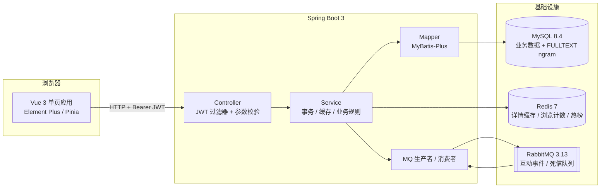

# Blog Platform · 全栈博客平台

<p>
  <a href="https://github.com/liujunbin04/blog-platform/actions/workflows/ci.yml"></a>
  
  
  
  
  
  
  
</p>

一个可直接运行的全栈博客平台：**Spring Boot 3 + Vue 3 + MySQL + Redis + RabbitMQ**，
覆盖注册登录、文章创作与发布、评论回复、点赞收藏、全文搜索、热度排行榜与站内通知的完整业务闭环，
Docker Compose 一键启动。

文章详情接口经 JMeter 阶梯加压调优，QPS 从 **264 提升到 5730（约 21 倍）**，
P95 延迟从 **343ms 降到 17ms**，详见 [性能优化记录](docs/文章详情接口性能优化.md)。

<!--
  截图：把图片放到 docs/images/ 下（建议 cover.png、article-detail.png、editor.png、profile.png），
  然后解除下面的注释。

## 界面预览

| 首页 | 文章详情 |
| --- | --- |
|  |  |

| 编辑器 | 个人中心 |
| --- | --- |
|  |  |
-->

## 功能一览

| 模块 | 能力 |
| --- | --- |
| 账号 | 注册 / 登录、BCrypt 密码存储、JWT 无状态认证、个人资料 |
| 文章 | Markdown 编辑、草稿与发布、作者可见的隐藏文章、软删除、分页列表、按时间 / 热度排序 |
| 互动 | 两级评论与回复、点赞（幂等 toggle）、收藏、我的收藏 |
| 发现 | MySQL FULLTEXT ngram 中文全文搜索、热门榜（Redis ZSET） |
| 通知 | 评论 / 点赞事件经 RabbitMQ 异步写入站内信，未读角标、全部已读 |
| 运维 | Docker Compose 编排、容器健康检查、死信队列查看与重放 |

## 技术栈

| 层次 | 选型 |
| --- | --- |
| 后端 | Java 17、Spring Boot 3.5、Spring Security、MyBatis-Plus、JJWT |
| 数据 | MySQL 8.4（业务数据 + FULLTEXT ngram）、Redis 7（缓存 / 计数 / 热榜）、RabbitMQ 3.13 |
| 前端 | Vue 3.5、TypeScript、Vite 8、Element Plus、Pinia、Vue Router、markdown-it |
| 工程 | Docker Compose、JUnit 5 + Mockito、Vitest、ESLint + oxlint + Prettier、JMeter |

## 架构



## 技术亮点

### 1. 文章详情接口 21 倍性能提升

原实现把读接口当写接口做：每个请求一个事务，内含 2 次 SELECT + 1 次 `UPDATE view_count`。
`UPDATE` 带来同文章行锁排队，且 `innodb_flush_log_at_trx_commit=1` 让每次提交都要 fsync redo log。

| 并发 | 优化前 QPS | 优化后 QPS | 优化前 P95 | 优化后 P95 |
| --- | --- | --- | --- | --- |
| 20 | 261 | **5730** | 95ms | 5ms |
| 80 | 264 | 5664 | 343ms | **17ms** |
| 200 | 272 | 5515 | 793ms | 42ms |

改造要点：

- 浏览量改为 **Redis `INCR` + 每 5 分钟批量回写**，详情页不再产生写事务；
- 用 `SETNX` 初始化计数基线，回写采用**绝对值覆盖**而非累加，避免并发初始化与重复回写导致计数错误；
- 遍历计数 key 用 `SCAN` 而非 `KEYS`，避免阻塞 Redis 单线程；
- 通过 `@PreDestroy` 在停机前回写，减少未落盘增量丢失；
- 压测中额外验证并**证伪了「连接池不足」的假设**（池 10 → 50 对吞吐无影响），避免无效优化。

### 2. 缓存设计

- 文章详情缓存 TTL 10 分钟，**只缓存公开文章**（草稿 / 隐藏文章不进缓存）；
- 缓存未命中时用 Redisson 分布式锁串行化回源，防击穿；不缓存 null，防穿透；
- 浏览量单独走 Redis 计数、**不进入缓存对象**，避免每次访问都回写整个缓存；
- 把 `@Cacheable` 抽到独立 Bean，规避 Spring AOP **类内自调用导致注解静默失效**的坑。

### 3. 事件驱动与幂等

- 评论、点赞事件经 RabbitMQ 投递，通知服务异步落库，接口响应不被通知逻辑拖慢；
- `notification` 表用 `uk_event_key` 唯一索引做消费幂等，重复投递直接忽略；
- 配置死信队列，并提供管理端查看与重放接口，消费失败的消息可人工恢复。

### 4. 全文搜索的取舍

先用 Elasticsearch 8 + IK 分词实现过中文搜索，后因运维成本（自建镜像、512MB 堆、启动约 90 秒、
启动回填 + 增量同步 + 可见性对账的一致性链路）远超本地博客规模而移除，改用
**MySQL 8 FULLTEXT ngram**。查询契约（VO）保持不变，数据量增长后只需替换查询实现即可迁回。

### 5. 工程化

- 后端 18 个测试类 / 49 个用例，覆盖权限、参数校验、缓存与 MQ 消费等行为；
- 前端 Vue 3 + TypeScript，Vitest 组件测试 + 类型检查 + ESLint / oxlint / Prettier；
- GitHub Actions 对前后端分别执行测试与类型检查；
- JMeter 压测脚本、造数 / 清理 SQL 与压测报告一并入库，性能数字可复现。

## 快速开始

前置：Docker Desktop（含 Compose）。

```powershell
Copy-Item .env.example .env
node -e "console.log(require('crypto').randomBytes(64).toString('hex'))"
```

把生成的值填入 `.env` 的 `JWT_SECRET`，然后：

```powershell
docker compose up -d --build
docker compose ps
```

访问 <http://localhost:18081>（端口由 `.env` 的 `FRONTEND_PORT` 决定）。
局域网内其他设备访问 `http://<本机局域网IP>:18081`，需先放行防火墙，
见 [Docker 运行手册](docs/docker-runbook.md#局域网访问)。

## 本地开发

后端：

```powershell
$env:JWT_SECRET = "填入上一步生成的密钥"
cd blog
.\mvnw.cmd spring-boot:run
```

前端：

```powershell
cd frontend
npm ci
npm run dev
```

## 测试

```powershell
# 后端
cd blog
.\mvnw.cmd test

# 前端
cd ..\frontend
npm test
npm run type-check
npm run lint
```

## 项目结构

```
blog-platform/
├── blog/                 # Spring Boot 后端
│   └── src/main/java/com/example/blog/
│       ├── controller/   # 文章、评论、点赞、收藏、通知、用户
│       ├── service/      # 业务逻辑与缓存策略
│       ├── mapper/       # MyBatis-Plus 数据访问
│       ├── consumer/     # RabbitMQ 消费者
│       ├── task/         # 计数回写、热榜重建等定时任务
│       └── config/       # 安全、CORS、Redis、MQ 配置
├── frontend/             # Vue 3 前端
│   └── src/{views,components,api,stores,router}
├── docs/                 # 设计、压测与运行手册
├── jmeter/               # 压测脚本与造数 SQL
├── tools/                # 辅助脚本
└── docker-compose.yml    # MySQL / Redis / RabbitMQ / 前后端
```

## 接口概览

| 分组 | 主要路径 |
| --- | --- |
| 认证 | `POST /api/auth/register`、`POST /api/auth/login` |
| 文章 | `GET/POST /api/articles`、`GET/PUT/DELETE /api/articles/{id}`、`GET /api/articles/search`、`GET /api/articles/hot` |
| 评论 | `GET /api/comments/page`、`POST /api/comments`、`DELETE /api/comments/{id}` |
| 点赞 / 收藏 | `POST/DELETE /api/likes/{articleId}`、`POST/DELETE /api/favorites/{articleId}` |
| 通知 | `GET /api/notifications`、`PUT /api/notifications/read-all` |
| 运维 | `GET /api/admin/dlq`、`POST /api/admin/dlq/replay` |

## 文档

- [需求与数据库设计](docs/design.md)
- [文章详情接口性能优化](docs/文章详情接口性能优化.md)
- [JMeter 压测计划](docs/jmeter-文章详情压测计划.md)
- [Docker 运行手册](docs/docker-runbook.md)
- [手工冒烟测试清单](docs/smoke-test-manual.md)

## License

[MIT](LICENSE)